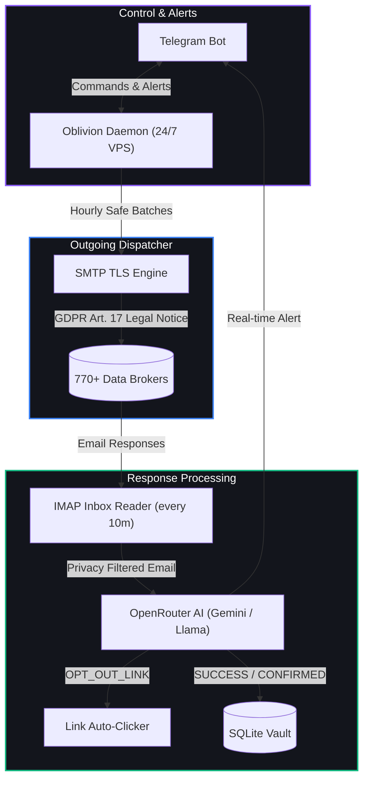

<p align="center">
  
  
  
  
  
</p>

<h1 align="center">🌌 Oblivion</h1>
<p align="center"><b>Autonomous AI-Powered GDPR &amp; Privacy Data Broker Eraser</b></p>
<p align="center"><i>Self-hosted 24/7 background daemon enforcing your GDPR Art. 17 Right to Erasure across 770+ data brokers.</i></p>

---

## Table of Contents

- [Overview](#overview)
- [Key Features](#key-features)
- [Architecture](#architecture)
- [Interactive Telegram Commands](#interactive-telegram-commands)
- [Quick Start](#quick-start)
- [Rate Limiting & Safety](#rate-limiting--safety)
- [Legal Disclaimer](#legal-disclaimer)
- [Feedback & Issues](#feedback--issues)
- [License](#license)

---

## Overview

Data brokers collect and trade personal identifiers like physical addresses, phone numbers, and background records. Most commercial services charge recurring annual subscriptions to dispatch basic email opt-outs.

**Oblivion** is an autonomous, self-hosted background service that handles the entire pipeline locally: dispatching legally compliant GDPR Art. 17 and Art. 21 erasure demands, interpreting incoming responses using open-source LLMs, automatically completing opt-out verification links, and providing real-time management via Telegram.

---

## Key Features

- **770+ Verified Brokers**: Built-in, deduplicated directory of global data brokers, people-search directories, and marketing aggregates.
- **AI Response Classifier**: Uses free-tier LLMs via OpenRouter (Gemini, Llama, Mistral) to read company replies and distinguish actual deletions from verification requirements or marketing emails.
- **Automated Link Verification**: Detects one-click confirmation links in incoming emails and visits them automatically.
- **Telegram Management**: Full control from mobile: trigger manual batches, inspect broker statuses, pause dispatching, or launch OSINT web searches.
- **Zero Cloud Storage**: Credentials, personal records, and interaction logs remain entirely on your own host inside an isolated SQLite database.

---

## Architecture



---

## Interactive Telegram Commands

| Command | Action |
|---|---|
| `/status` | Progress breakdown (requests sent, confirmed removals, pending queue) |
| `/brokers` | Search and inspect loaded data brokers |
| `/send_next` | Immediately dispatches the next batch of 3 GDPR requests |
| `/scan` | Runs background OSINT discovery for public mentions of your email/phone |
| `/add <domain>` | Manually adds any website to the removal queue (e.g. `/add spokeo.com`) |
| `/pause` / `/resume` | Toggles automated background dispatching |

---

## Quick Start

### 1. Clone & Install
```bash
git clone https://github.com/mrskelee/oblivion.git
cd oblivion
python3 -m venv venv
source venv/bin/activate
pip install -r requirements.txt
```

### 2. Configure Environment
```bash
cp .env.example .env
nano .env
```
Set your parameters:
- `USER_FULL_NAME`, `USER_EMAILS`, `USER_PHONE`: Your identification details for the legal notices.
- `OPENROUTER_API_KEY`: Free key from [openrouter.ai](https://openrouter.ai/keys).
- `TELEGRAM_BOT_TOKEN`, `TELEGRAM_CHAT_ID`: From [@BotFather](https://t.me/BotFather) and [@userinfobot](https://t.me/userinfobot).
- `EMAIL_USER`, `EMAIL_PASSWORD`: Your email address and App Password.

### 3. Start Background Daemon
```bash
# Run inside a detached screen session
screen -dmS oblivion bash -c "source venv/bin/activate && python3 main.py start"

# Reattach to check logs
screen -r oblivion
```

---

## Rate Limiting & Safety

Data broker removal requires contacting hundreds of separate companies. Oblivion applies strict safeguards to prevent mail account flags or spam detection:

1. **Controlled Dispatch**: Requests are sent in small batches (default: 3 per hour).
2. **Polite Sleep Intervals**: Brief randomized pauses between individual outgoing emails.
3. **Provider Thresholds**: Keeps daily output well below consumer caps (e.g., Gmail's 500 emails/day ceiling).
4. **Smart Inbox Isolation**: Personal mail (receipts, notifications) is ignored; only emails originating from known brokers or matching GDPR keywords are analyzed.

---

## Legal Disclaimer

> **Oblivion is an automated tool designed solely for exercising lawful personal privacy rights under GDPR (Art. 17 & 21) and CCPA.**
> Users are responsible for ensuring that deletion requests reflect their own verified identifiers.

---

## Feedback & Issues

Oblivion is an evolving, community-driven project and may not be 100% perfect in every edge case. If you have feature suggestions, encounter unexpected responses, or discover outdated broker endpoints, please feel free to [open an Issue](https://github.com/MrSkelee/oblivion/issues) or submit a Pull Request.

---

## License

Distributed under the [GNU General Public License v3.0](LICENSE).

<p align="center">
  <b>Built by the Oblivion Project</b><br>
  <i>Reclaim your digital autonomy. Leave no trace.</i>
</p>
